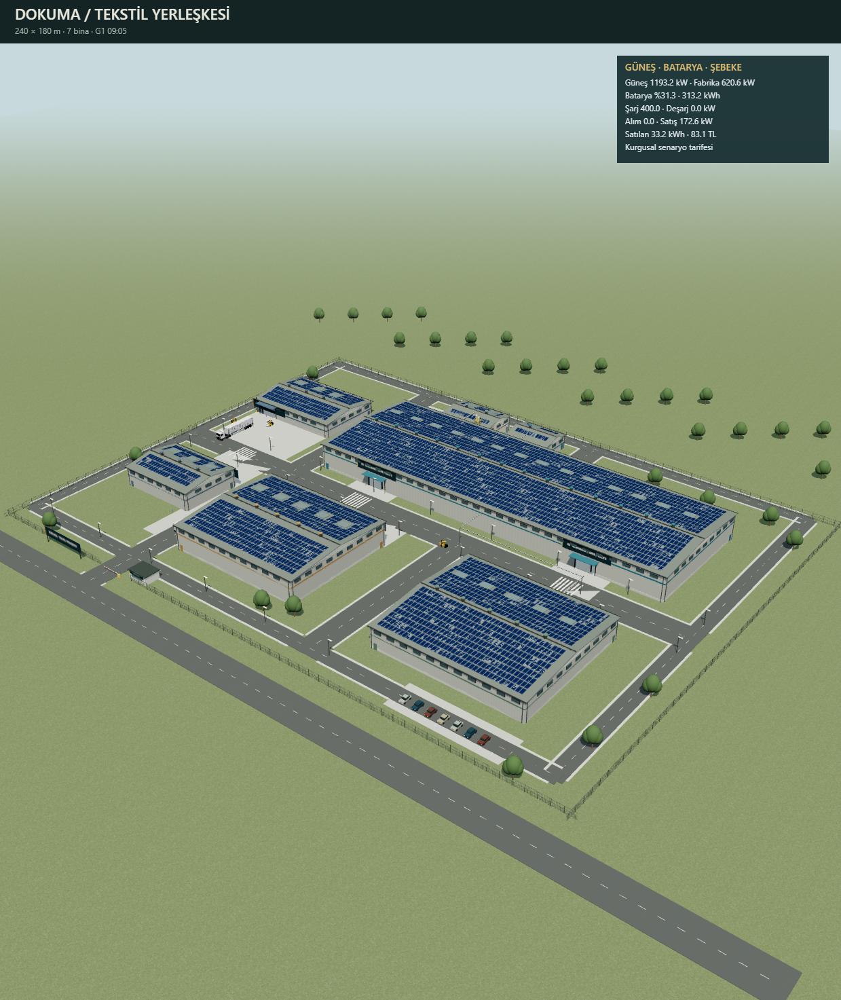
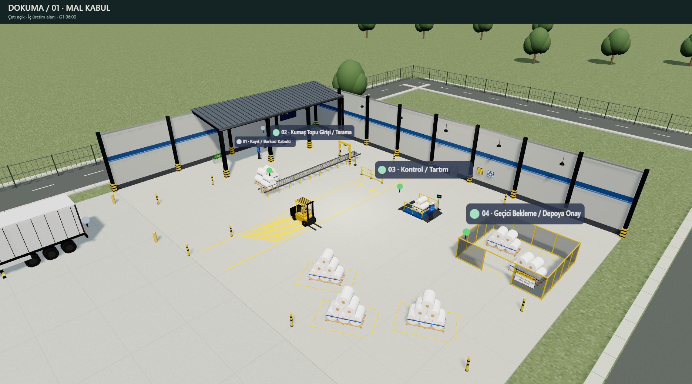
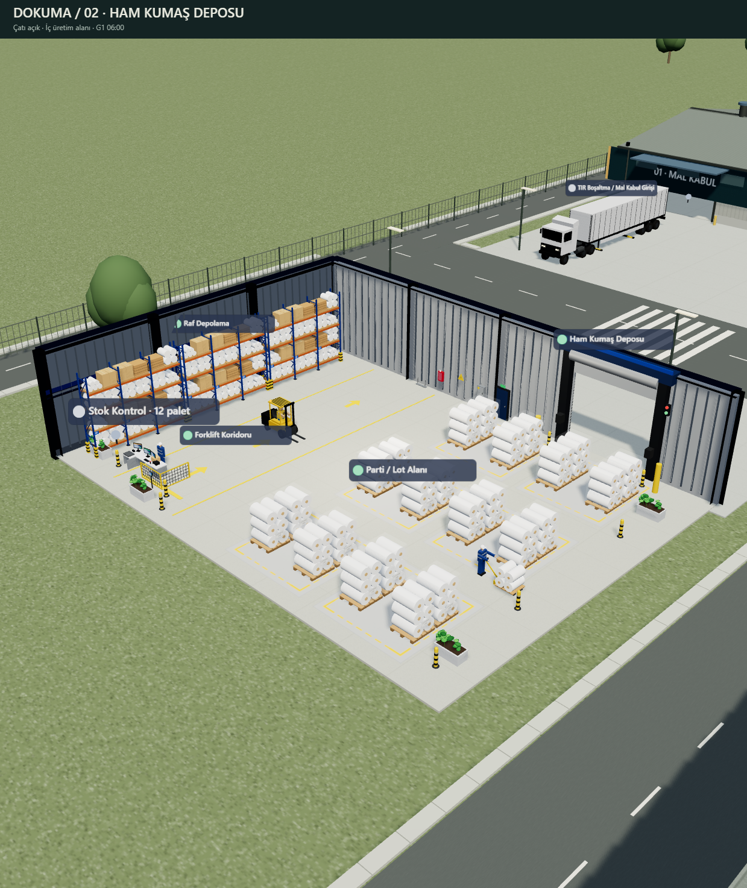
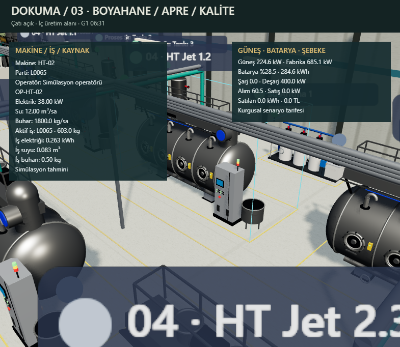
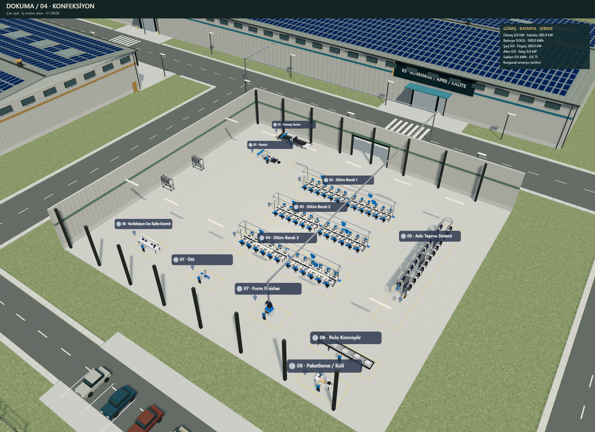
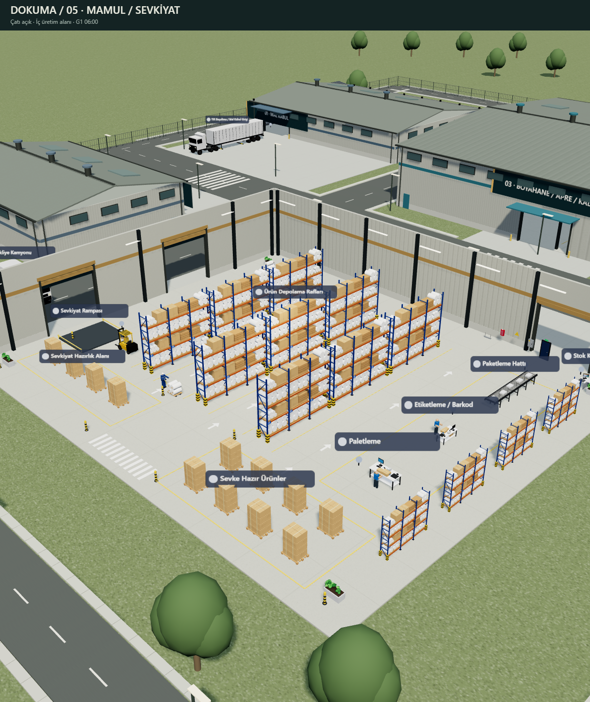
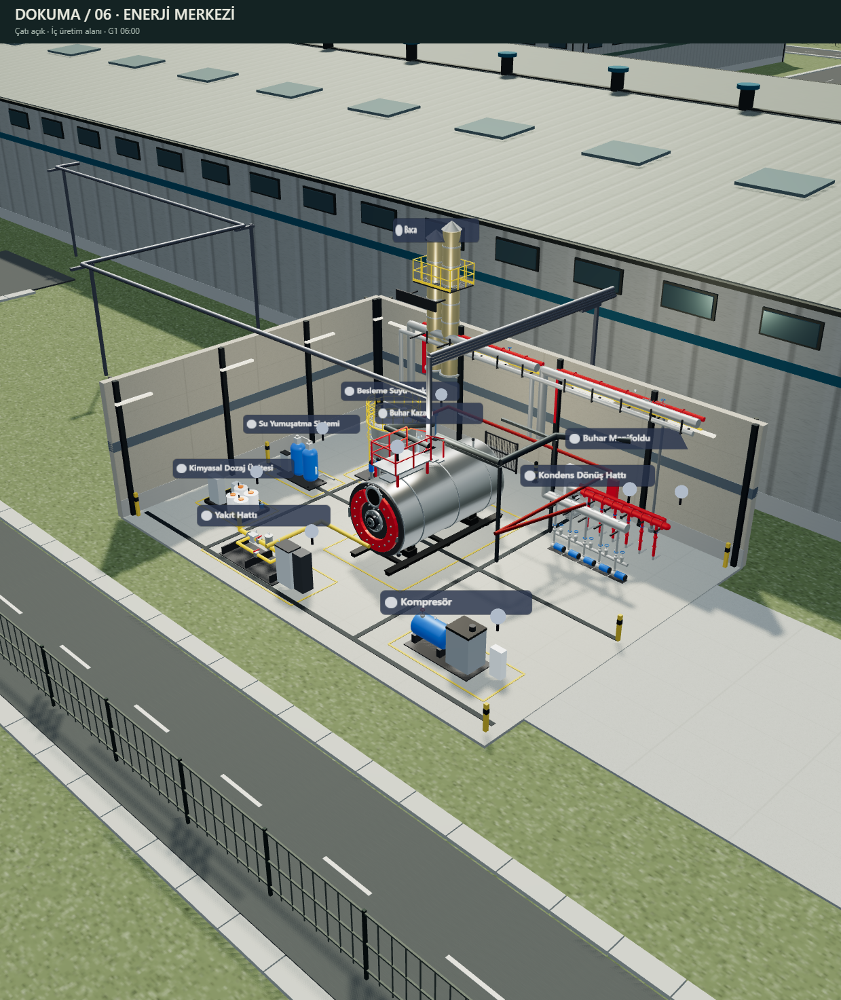
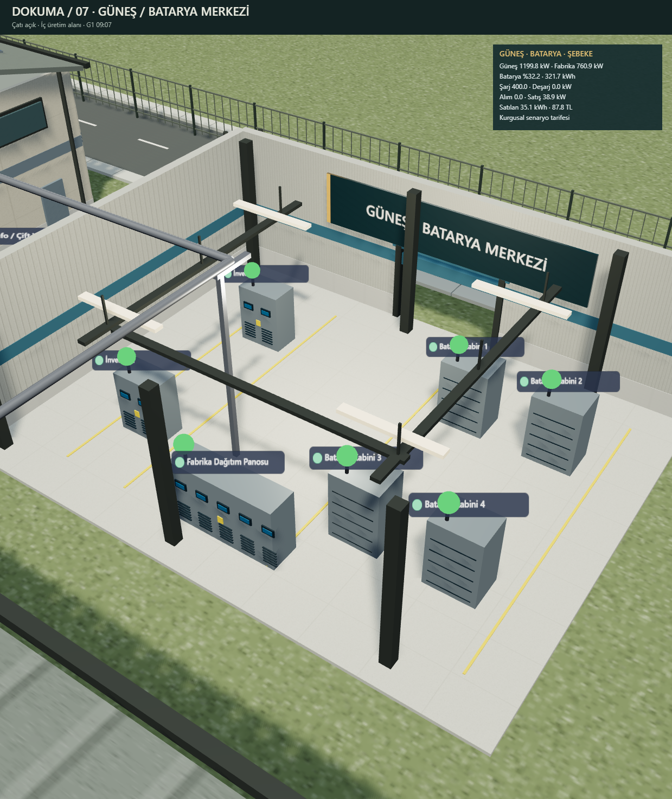

# DOKUMA · 3D Tekstil Fabrikası Simülasyonu

**Three.js ve TypeScript ile tarayıcıda çalışan, üretim ve enerji akışlarını birlikte izleyen bir tekstil fabrikası.**

A browser-based textile factory simulation with interactive 3D buildings, animated production lines, physical logistics, and solar/battery energy scenarios. The interface and detailed documentation are in Turkish.

<p align="center">
  
</p>

240 × 209 m yerleşke · 7 üretim ve enerji binası + yönetim binası ve mağaza · 91 ekipman · 74 üretim bağlantısı · 3.402 güneş paneli

## Özellikler

- **Uçtan uca üretim:** mal kabul → ham kumaş deposu → boyahane / apre / kalite → konfeksiyon → mamul depo / sevkiyat.
- **İnteraktif 3D sahne:** bina inceleme, açılan çatılar, makine seçimi, gündüz/gece görünümü ve düzenlenebilir yerleşim.
- **Yönetim binası:** üç katta 13 birim; kat kesiti ve birim odağıyla SCADA izleme odası, lobi, kafeterya, bilgi işlem, yönetim, tasarım, planlama ve laboratuvar alanlarını inceleme.
- **Mağaza ve sosyal alanlar:** Eco-Tex fabrika satış showroom'u, açık kafeterya ve güneş panelli EV şarj otoparkı.
- **Güncellenen arayüz:** gruplandırılmış araç çubuğu, bina seçimleri, birim kartları ve kat geçişleri.
- **Hareketli lojistik:** fiziksel yük taşıyan forkliftler, kumaş arabaları, kapı ve koridorları kullanan üretim güzergâhları.
- **Konfeksiyon animasyonları:** üç dikim bandında toplam 72 operatör, kesim, askı taşıma, ütü ve koli paketleme.
- **Üretim takibi:** parti numaraları, kuyruklar, WIP, sevkiyat, arızalar, onarım ve yardımcı tesis beklemeleri.
- **Kaynak ve enerji hesabı:** iş bazında elektrik/su/buhar tüketimi; güneş üretimi, 1.000 kWh batarya, şebeke alımı ve fazla üretim satışı senaryosu.
- **Yerel kayıt:** tarayıcıda saklanan yerleşim, JSON içe/dışa aktarımı ve PNG sahne çıktısı.
- **Yerel modeller:** GLB dosyaları repoya dahildir; eksik modeller için prosedürel karşılıklar bulunur.

## Ekran görüntüleri

Aşağıdaki PNG'ler uygulamadan alınmış gerçek sahne çıktılarıdır. Tam boyut için bir görsele tıklayın. Görseller farklı geliştirme aşamalarını ve simülasyon anlarını gösterir.

| Mal kabul | Ham kumaş deposu |
| :---: | :---: |
| [](docs/screenshots/receiving.png) | [](docs/screenshots/raw-warehouse.png) |

| Boyahane ve iş kaynakları | Konfeksiyon |
| :---: | :---: |
| [](docs/screenshots/dyeing-resources.png) | [](docs/screenshots/garment.png) |

| Mamul depo ve sevkiyat | Enerji merkezi |
| :---: | :---: |
| [](docs/screenshots/shipping.png) | [](docs/screenshots/utilities.png) |

<p align="center">
  <a href="docs/screenshots/solar-battery.png"></a>
  <br /><em>Güneş / batarya merkezi ve anlık güç bilançosu</em>
</p>

## Kurulum ve çalıştırma

Node.js 20+ ve npm gerekir. WebGL destekleyen bir masaüstü tarayıcı kullanın.

```sh
git clone https://github.com/EgeKrts/factory-simulation.git
cd factory-simulation
npm ci
npm run dev -- --host 127.0.0.1
```

Terminalde yazan yerel adresi açın. Üretim derlemesi:

```sh
npm run build
```

Derlenen uygulama ve modeller `dist/` klasörüne yazılır.

## Kullanım

1. Bir binaya tıklayın veya **Bina seç** listesinden seçin; çatısı açılır. **Yerleşke** genel görünüme döner.
2. Fare ile döndürün ve yakınlaşın; **WASD** ile kamerayı kaydırın.
3. Makine listesinden bir istasyon seçerek parti, operatör, arıza ve kaynak tüketimini inceleyin.
4. Hız düğmeleriyle simülasyonu çalıştırın; **Gündüz / Gece** ile sahne ışığını değiştirin.
5. **Düzenle** ile makineleri taşıyın/döndürün ve yerleşimi JSON olarak aktarın. **Görsel ↓** sahneyi PNG olarak kaydeder.
6. Yönetim binasına tıklayın; **Kat kesiti** düğmeleriyle katı, birim kartlarıyla odayı seçin. **Tüm bina** dış görünümü açar; **Çıkış** bina incelemesini kapatır.
7. **Bina seç** listesinden **Eco-Tex Mağaza & Showroom** veya **Açık Kafeterya & EV Otopark** alanına geçin.

Yerel adrese `?inspect=receiving`, `?inspect=raw`, `?inspect=dye`, `?inspect=garment`, `?inspect=warehouse`, `?inspect=utility` veya `?inspect=power` eklemek ilgili binayı gündüz ve duraklatılmış olarak açar.

## Doğrulama

```sh
npm run typecheck
npm test
npm run simtest
npm run build
```

19 Ekim 2026 kontrolünde üretim derlemesi, kampüs/lojistik testleri ve simülasyon senaryosu geçti. Testler 74 üretim güzergâhını, kayıt geçişlerini, yük taşıma animasyonlarını, arıza/onarımı, iş tüketimlerini ve güneş/batarya enerji bilançosunu kapsar. Vite, Three.js içeren ana paket için 500 kB boyut uyarısı verir; derleme tamamlanır.

## Proje yapısı

| Konum | İçerik |
| --- | --- |
| `src/` | Üretim motoru, 3D sahne, bölüm görünümleri, navigasyon ve testler |
| `src/adminBuilding.ts`, `src/adminLayout.ts` | Yönetim binası, kat kesitleri, birimler ve yerleşim geçişi |
| `src/ecoStore.ts`, `src/outdoorComplex.ts` | Mağaza, açık kafeterya ve EV şarj otoparkı |
| `public/assets/` | GLB modelleri, model eşlemeleri ve mal kabul kaynakları |
| `public/assets/yonetim-bina/yonetim-bina.glb` | Yönetim binası modeli |
| `public/layouts/default.layout.json` | Varsayılan fabrika yerleşimi |
| `scripts/` | Yerleşim üretimi ve model aktarım araçları |
| `docs/screenshots/` | README'de gösterilen sahne görüntüleri |

[Model ekleme ve GLB ayarları](public/assets/README.md) · [Ayrıntılı teknik notlar ve geliştirme kayıtları](docs/technical-notes.md)

Kaynak tüketimleri ve enerji tarifeleri düzenlenebilir simülasyon tahminleridir. Uygulama gerçek sayaçlara veya şebekeye bağlı değildir. Yerleşim kayıtları tarayıcının `localStorage` alanında tutulur.
